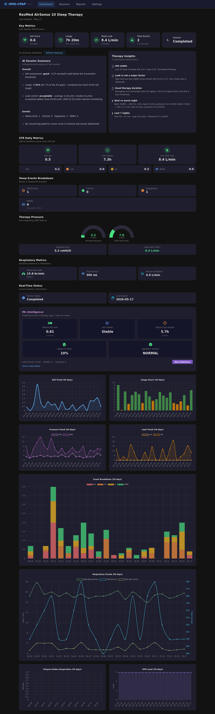

# HMS-CPAP

[](https://opensource.org/licenses/MIT)
[](https://github.com/hms-homelab/hms-cpap/pkgs/container/hms-cpap)
[](https://github.com/hms-homelab/hms-cpap/actions)
[](https://www.buymeacoffee.com/aamat09)

**A small, local-only CPAP data viewer. Reads your machine's SD card, shows you your nights in a web dashboard, and (optionally) publishes them to Home Assistant.**

> ### Not a medical device
>
> HMS-CPAP is a hobbyist data viewer. It is not a medical device, is not cleared
> by any regulator, and cannot diagnose anything or tell you whether your
> therapy is working. **Never change your therapy settings based on this
> software.** Talk to the clinician who manages your therapy. The numbers can be
> wrong: the parsers read undocumented, reverse-engineered formats.
>
> Read [DISCLAIMER.md](DISCLAIMER.md) before using this. By using it you accept
> the [Terms of Use](TERMS.md). Not affiliated with ResMed, Philips, Löwenstein,
> Sefam, BMC, React Health, SleepHQ, or anyone else named here. See [NOTICE](NOTICE).



## What it is

A C++ service with a built-in Angular web UI. It takes the files your CPAP
writes to its SD card (from a Sleep Bridge Lite listening on the card, from
the machine's own Bluetooth, over WiFi from an ez Share or Toshiba FlashAir
card, or from a folder), parses them itself, stores the results in a database,
and shows you the data. It is a fully local-first experience.

**Supported machines**

| Manufacturer | Models | Live sessions |
|---|---|---|
| ResMed | AirSense 10, AirSense 11 | Yes, charts update every 65s during therapy |
| Lowenstein | Prisma Line (20A, 20C, 25S, 25ST), Prisma Smart (Max, Plus, Soft) | No, files are written after each session |
| Sefam | S.Box AUTO (1263R), SleepBox AUTO (1200R) | No, the card is read after the night |
| BMC / React Health | Luna | No, the card is read after the night |

On a Sefam card you get the recorded signals, breath-by-breath respiratory
mechanics, and apneas. **You do not get an AHI.** The machine records apneas but
does not mark hypopneas in a form anyone outside Sefam can read, so HMS-CPAP
shows an apnea-only index and labels it as one. It will read lower than the AHI
a ResMed reports for the same night. That is a different measurement, not a
better night.

On a Luna card you get pressure, leak, respiratory rate and I:E ratio per minute, and the apneas the
machine marks itself (obstructive and clear airway). On a bi-level Luna, IPAP,
EPAP and pressure support are reported too. There is no flow waveform yet: its
scale on the card is not known, and a number in the wrong unit is worse than
none. A Luna is read from a local folder or the upload page, not from a WiFi
SD card.

## Features

- **Dashboard** with the key numbers per night, 30-day trends, pressure gauges, and a per-night CpapDash Index (usage + AHI + leak in one number)
- **Session detail** with 13 zoomable signal charts, event markers, and live view while you sleep (ResMed)
- **Events explorer**: every respiratory event across all nights, filterable by date, type, and duration
- **PDF reports** for a date range, made for handing to your doctor
- **Pulse oximetry**: Wellue O2Ring SpO2/HR overlay with ODI, imported by CSV upload
- **Sleep Bridge Lite receiver**: a bridge on the SD card's wires sends every write to hms-cpap as the machine makes it, and the card's files are rebuilt here, live
- **AirSense 11 over Bluetooth** (off by default): this computer pairs with the machine itself and reads its daily summary and its live night, no card involved; a Mule & Miner in the same mode can send the night here instead
- **Manual upload page**: drag in a CPAP `.zip` or O2Ring `.csv` from any browser, no shared network needed
- **Home Assistant**: 47+ sensors via MQTT auto-discovery, or install it as an add-on and run it inside HA
- **Equipment & supply reminders**: track mask, filters, tubing per profile; days-left sensors and due/overdue events for automations
- **SleepHQ export** (off by default): forward each finished night to SleepHQ
- **ResMed myAir comparison** (off by default, read-only): put ResMed's own nightly score next to CpapDash's
- **LLM night summaries** (off by default): plain-language write-ups via Ollama or any OpenAI-compatible endpoint
- **ML insights** (off by default): AHI prediction, compliance forecast, mask-fit risk, anomaly detection
- **Any database**: SQLite (default, zero setup), PostgreSQL, or MySQL/MariaDB
- **Runs on** Windows, macOS, Linux, Raspberry Pi, Docker, or as a Home Assistant add-on

## Install

Pick one. Every path ends at the same four-screen setup wizard in your browser:
where to store data, where the data comes from, which optional extras to turn
on, and whether to start at boot.

### Home Assistant add-on (easiest if you run HA)

Settings -> Apps -> three dots -> Repositories, add:

```
https://github.com/hms-homelab/hms-cpap-ha-addon
```

Install **CpapDash**, start it, and the wizard opens through Ingress. No port to
open, no second password; the MQTT broker's credentials are picked up
automatically.

### Windows

Download `HmsCpapInstaller-Setup.exe` from
[Releases](https://github.com/hms-homelab/hms-cpap/releases) and run it. No
admin rights needed. A tray icon gives you Open Dashboard, Sync Now, and Start
at Login.

### macOS

Download `hms-cpap-macos-arm64.zip` from
[Releases](https://github.com/hms-homelab/hms-cpap/releases), unzip, run:

```bash
./hms_cpap
```

Your browser opens on http://localhost:8893/setup.

### Raspberry Pi and Linux (Docker)

The image on GHCR is built for `arm64` and `amd64`, so it runs as-is on a
64-bit Pi 3/4/5 or any x86 Linux box. Nothing to compile.

```bash
docker run -d --name hms-cpap -p 8893:8893 \
  -v cpap_config:/config -v cpap_data:/data \
  ghcr.io/hms-homelab/hms-cpap:latest
```

Open http://localhost:8893/setup. Config lives in the `cpap_config` volume and
data in `cpap_data`; neither is touched by image updates.

For a Sleep Bridge Lite or a Mule & Miner sending a night here, publish the
stream port as well: add `-p 8894:8894` to the line above (the compose file
already does).

To read an O2 ring or an AirSense 11 over the host's own Bluetooth, give the
container the host's D-Bus as well: add `-v /run/dbus:/run/dbus:ro` to the
line above. Without it everything else runs and Settings says there is no
Bluetooth adapter.

If you'd rather have PostgreSQL and an MQTT broker alongside it, clone the repo
and run `docker compose up -d` instead; it brings up all three and waits for
the database before starting CpapDash.

A Pi that already runs Home Assistant can skip Docker entirely and use the
add-on above.

### Linux (build from source)

```bash
git clone https://github.com/hms-homelab/hms-cpap.git
cd hms-cpap
./build_and_deploy.sh --deploy   # builds frontend + backend, runs tests, installs the systemd unit
```

Or without the script: `mkdir build && cd build && cmake .. && make -j$(nproc) && ./hms_cpap`.

### Getting the data off the machine

There are five ways to get the nights in. The first is the one to pick if you
are starting today; the others are here for the hardware you already have.
Whatever the way, the result is the same: card files on this computer, parsed
by hms-cpap.

> **ResMed AirSense 11 with REF 39517 on the label underneath:** its SD slot
> can't power a WiFi SD card reliably, so don't use an ez Share or a Toshiba
> FlashAir in it (4 below). Every other way works: a Sleep Bridge Lite (1,
> powered over USB-C, not by the slot), the machine's own Bluetooth (2 and 3),
> a local folder or the upload page (5).

#### 1. Sleep Bridge Lite (recommended)

From the Sleep Bridge series, the Lite connects directly to the CPAP's SD slot
and streams the data while the machine writes to the card, without
interrupting the machine's own writes. It is powered over USB-C, not by the
slot, and the card stays in the machine and stays the machine's. The Lite
pairs with hms-cpap on port 8894 for the live signal, and hms-cpap rebuilds
the card's files from what it streams into a folder it reads like any card.
The device and what it does are introduced in
[Introducing Sleep Bridge Lite](https://www.cpapdash.com/blog/introducing-sleep-bridge-lite).

Supported today: ResMed AirSense 10 and 11. Coming soon, not supported yet:
the AirCurve machines and the BMC Luna G3; further along, the Philips
DreamStation 2. The brand work happens once, in the bridge, and hms-cpap
reads a card as it always has. That is what makes hms-cpap brand agnostic,
and what brings real-time capture of therapy to every machine the bridge
supports.

Setting it up:

1. hms-cpap listens for a bridge out of the box. In `config.json` that is
   `"sleep_bridge": { "enabled": true, "port": 8894 }`. In Docker publish
   `-p 8894:8894`; the Home Assistant add-on publishes it already. Only the
   stream answers on that port, never the web UI, and it has no login: keep
   it on your local network.
2. On the bridge's setup page (hold its button 10 seconds to reopen it),
   choose **My hms-cpap** and type the IP address or hostname of this
   computer, and the port: 8894 unless you changed `sleep_bridge.port` in
   hms-cpap. The bridge tests the address before it keeps it.
3. Power the machine off and on once, outside therapy. The machine reads the
   card when it starts, and seeing that read is what lets the rebuild trust
   the card's layout. Until then hms-cpap holds what it receives and writes
   no file.
4. The rebuilt card lands in `<data dir>/sleepbridge/<bridge>/`, in the
   machine's own layout. The data dir is `~/.hms-cpap` natively, `/config`
   in the Docker image (the `cpap_config` volume) and `/data` in the add-on.
   Point a **Local folder** source at that folder (5 below), ResMed format.
   `GET /api/sleepbridge` lists every bridge with its folder (`card_root`),
   the machine it recognised (`card_machine`) and the format to read it with
   (`card_format`).

What you see: the night grows while you sleep. Each write reaches hms-cpap
as the machine makes it, and the dashboard follows on its sync interval. A
file is written only once every sector of it has been seen; a file that
stays held (listed in the bridge folder's `batches/held.json`) is one whose
first part was written while the bridge was not listening, before it was
powered or while hms-cpap was away longer than the bridge can hold. It is
never written with holes in it. The bridge keeps more than a night of writes
in its own memory while hms-cpap is unreachable and sends them when it
answers again.

The limit: the bridge forwards writes, so it only has what the machine wrote
while it was powered and listening. Nothing already on the card from before
is read through it. For the history already on the card, read the card once
in a reader (5 below) and let the bridge carry on from there.

The receiver is new in this version. The wire protocol is in
[docs/SLEEP_BRIDGE_LOCAL_STREAM.md](docs/SLEEP_BRIDGE_LOCAL_STREAM.md); the
part that rebuilds files from the stream is a prebuilt component under its
own licence, linked only into builds made with `-DBUILD_WITH_SLEEPBRIDGE=ON`
(off by default from source; the Docker image takes
`--build-arg SLEEPBRIDGE=ON` once the component's asset is pinned in
`cmake/sleepbridge-pins.cmake`, and the published image is built without it
until then). A build without it still listens and refuses
every bridge, so a bridge's setup test fails rather than leaving it pointed at
a receiver that cannot use what it sends.

#### 2. AirSense 11 over Bluetooth from a computer

If your PC has Bluetooth and you own an AirSense 11 or an AirCurve 11, you do
not need a bridge at all: hms-cpap connects to the machine directly and shows
your nights live. The machine has its own Bluetooth, and hms-cpap becomes the
device it talks to. This needs Linux with BlueZ, a build made with
`-DBUILD_WITH_BLE=ON` (the Docker image is; give the container the host's
D-Bus, see the Docker section) and a Bluetooth adapter in range of the
machine. New in this version.

Turn it on in `config.json`:

```json
"airsense11_ble": { "enabled": true, "address": "" }
```

`address` is optional: left empty, the first AirSense 11 the scan finds is
used. Then pair from **Settings, AirSense 11 over Bluetooth**: press **Pair
AirSense 11**, read the code off the machine's screen and type it within the
minute the machine allows. The machine holds one pairing at a time, so this
replaces the myAir app's pairing (and a bridge's); myAir's nightly reports
keep arriving over the machine's own modem. The pairing is kept in
`<data dir>/as11.json`, never in `config.json`.

What you get:

- **The daily summary**: the machine's own figures for each therapy day, the
  same ones its `STR.edf` carries, pulled every `airsense11.pull_hours` (6 by
  default) and stored as STR days, so the dashboard, trends and reports show
  them.
- **The live night**: while therapy runs, the machine streams flow, mask
  pressure, leak, respiratory rate, tidal volume, minute ventilation, snore
  and flow limitation, and its own scored events. hms-cpap writes them as a
  card under `<data dir>/as11/<machine serial>/`: `DATALOG/<night>/` with
  BRP, PLD, EVE and CSL files (SAD when an oximeter rode along), the
  machine's `Identification.json`, and an `STR.edf` built from the summaries
  when the model's layout is known. Each file is a valid EDF at every moment,
  rewritten as the stream goes. When the night ends it goes through the same
  session import as a card's files and lands as its own session, with its
  metrics, files and the night's summary, whatever source the rest of the
  setup reads (none, a card, a WiFi card); nights found on disk at start-up
  that the database does not hold are imported then. A card read beside it
  wins the stretches it carries: a card session overlapping a Bluetooth one
  in time replaces it, and the Bluetooth session stays where the card has
  nothing. Pointing a **Local folder** source at the folder (5 below) is no
  longer needed, and still works for reading the night while it is being
  written.

The older summary-only path through a bridge's HTTP (`"airsense11": {
"enabled": true, "mule_url": "http://..." }`) still works for a unit that
offers it; with `airsense11_ble` on it is not used.

#### 3. A Mule & Miner in AirSense 11 Bluetooth mode

The Mule & Miner now transmits to hms-cpap locally, so if your desktop PC is
too far from the CPAP for its own Bluetooth, the Mule & Miner bridges that
gap. The CpapDash dual-radio unit holds the machine's Bluetooth pairing
instead of this computer, and sends the night here instead of to the cloud.
On the unit, set the hms-cpap address to this computer's IP address or
hostname (nothing else: no `ws://`, no port, no path) and the port, 8894
unless you changed `sleep_bridge.port`; it connects to
`ws://<host>:<port>/mule/v1/device`, the same port the Sleep Bridge receiver
listens on, so `sleep_bridge.enabled` must stay on.

It feeds the same writer as 2 above: the same files under
`<data dir>/as11/<machine serial>/`, the same live night, imported as a
session the same way when it ends. Every block and every event also wakes
hms-cpap's sync at once, and with MQTT on each event and each therapy start
and end goes to the broker as it arrives (`cpap/<device_id>/live/...`), for
automations during the night. When the night ends the unit is asked for the
machine's identification, summary and settings history; the summary is what
builds the folder's `STR.edf`. `GET /api/mule` lists the units seen. New in this version; the
protocol is in [docs/MULE_LOCAL_STREAM.md](docs/MULE_LOCAL_STREAM.md).

#### 4. WiFi SD cards (ez Share and Toshiba FlashAir)

A WiFi SD card sits in the CPAP's SD slot in place of the plain card and
serves the card's files over WiFi; hms-cpap polls it and copies what is new
into an `archive_dir`, which both cards need. The ez Share was the original
path and the FlashAir came after it. Neither is the recommended path any
more: the card's WiFi runs on the machine's slot power through the night,
and some machines cannot hold it (the AirSense 11 REF 39517 above), which
shows up as brownouts and card errors; and a card reader only ever sees what
the card already holds, after the card holds it. A Sleep Bridge Lite leaves
the card alone and sees each write as it is made. If your WiFi card works
today, nothing here stops working.

**ez Share.** The card makes its own network, so you need a bridge such as
[hms-mm](https://github.com/hms-homelab/hms-mm) (Mule & Miner) to put it on
your LAN; the wizard can scan for one. To set a bridge up, the
[hms-mm web flasher](https://hms-homelab.github.io/hms-mm/) flashes both of
its boards from Chrome and takes your WiFi details on the same page, nothing
to install. In `config.json`: `"transport": "ezshare"`, `"ezshare_url":
"http://192.168.4.1"`, `"ezshare_range": true` (set it false for a card that
does not resume downloads), and an `archive_dir`. Works with a ResMed card
and a Sefam S.Box card. For a Sefam card the card is copied to the archive,
all of it on the first run and then its last two nights.

**Toshiba FlashAir.** The card joins your home WiFi itself, so no bridge is
needed. Set it to join your network (`APPMODE=5` in its `SD_WLAN/CONFIG`)
and pick FlashAir in the wizard; it is found as `http://flashair.local`, or
give its address. In `config.json`: `"transport": "flashair"`,
`"flashair_url": "http://flashair.local"`, and an `archive_dir`. ResMed
cards only. Tested on a FlashAir W-02 in an AirSense 10, read live through a
full night.

#### 5. Local folder and the upload page

- **Local folder**: point the wizard at the SD card root (the folder that
  holds both `STR.edf` and `DATALOG/`), on a USB reader, a NAS share, or any
  mount, and say which machine wrote it. In `config.json`: `"transport":
  "local"`, `"local_dir"`, and `"format"`: `resmed`, `lowenstein` (a Prisma
  tree, a serial folder with no `DATALOG`), `sefam`, or `bmc` for a Luna. A
  path one level too deep is refused rather than guessed. This is also how
  the folders written by a Sleep Bridge Lite (1) and the AirSense 11 streams
  (2 and 3) are read.
- **Upload page**: zip the card and drop it in the browser. A ResMed, Sefam,
  Löwenstein or Luna card is recognised by its files, and every night not yet
  stored is imported. No shared network needed.

Everything else (config keys, CLI flags, MQTT sensor list, myAir setup,
architecture, development, cross-compiling) is in
**[docs/REFERENCE.md](docs/REFERENCE.md)**.

### How it is built

The [`architecture/`](architecture/) folder maps the code:

- **[architecture/db.md](architecture/db.md)**: every table on SQLite, MySQL
  and PostgreSQL, how they are keyed and related, who writes and reads each
  one, and the time rules every date follows.
- **[architecture/layers.md](architecture/layers.md)**: the layers of the app
  (entities, the database layer, services, the web query layer, controllers,
  the frontend) and how a web request and a collection burst travel through
  them.

## Disclaimers

- **Not a medical device.** It does not diagnose anything and it is not a
  monitoring or alarm system. Never adjust your therapy based on this software.
  [DISCLAIMER.md](DISCLAIMER.md)
- **The data can be wrong.** Parsers are reverse-engineered from undocumented
  formats and collection can fail silently. Cross-check with your clinician or
  the manufacturer's own tools.
- **No authentication.** The web UI has no login. Keep it on your LAN; do not
  expose it to the internet.
- **Privacy.** There is no telemetry and nothing phones home. The only outbound integrations are
  SleepHQ, CpapDash sync, myAir, and LLM summaries, all off by default and each
  one you enable yourself. [PRIVACY.md](PRIVACY.md)
- **Independence.** Not affiliated with or endorsed by ResMed, Philips,
  Lowenstein Medical, Sefam, BMC, React Health, SleepHQ, or any other company named here. Trademarks
  belong to their owners. No OSCAR source was copied or derived from; it was
  consulted only to understand file formats. [NOTICE](NOTICE)
- **License.** MIT. Use it, modify it, sell it; keep the notice.
  [LICENSE](LICENSE) · [TERMS.md](TERMS.md)
- **Sleep Bridge component.** The part that rebuilds card files from a Sleep
  Bridge's stream is not MIT source: it is a prebuilt binary under its own
  licence, [LICENSE-sleepbridge](LICENSE-sleepbridge), linked only into builds
  made with `BUILD_WITH_SLEEPBRIDGE=ON`. The stream itself is documented in
  [docs/SLEEP_BRIDGE_LOCAL_STREAM.md](docs/SLEEP_BRIDGE_LOCAL_STREAM.md).

## Contributing & support

Fork, branch, add tests, make sure `./tests/run_tests` passes, open a PR. See
[docs/CONTRIBUTING.md](docs/CONTRIBUTING.md).

If this project is useful to you, consider
[buying me a coffee](https://www.buymeacoffee.com/aamat09) or starring the repo.
